# Plano Diretor de Refatoração Python (Design Patterns & Arquitetura 3.13+)

Este diretório contém o plano estratégico e tático de refatoração das 4 aplicações Python do **Flauzino Assistant** (`finance_api`, `agent_api`, `graph_api` e `telegram_api`), fundamentado nas 6 skills oficiais de arquitetura e padrões de projeto Python 3.13+:

1. **`python-fastapi-architecture`**: Separação estrita `Router -> Service -> Repository`, Injeção de Dependências com `Annotated` + `Depends`, exceções de domínio puras e serialização idiomática via `response_model`.
2. **`python-pattern-repository-service`**: Contratos estruturais com `Protocol` e Genéricos PEP 695 (`class RepositoryProtocol[T, ID](Protocol)`), isolamento de SQL/ORM e testes unitários rápidos com *In-Memory Fake Repositories*.
3. **`python-pattern-chain-of-responsibility`**: Pipelines sequenciais baseados em `HandlerProtocol[T]` e `BaseHandler[T]` (ou `Callable` funcional) com *short-circuit* (retorno antecipado) e Responsabilidade Única (SRP).
4. **`python-pattern-strategy`**: Substituição de cadeias `if/elif/else` por algoritmos intercambiáveis via `Protocol` + Tabelas de Despacho (`dict[StrEnum, Strategy]`).
5. **`python-pattern-factory`**: Criação desacoplada de objetos complexos/famílias via `Factory` + `Registry` (`dict[StrEnum, CreatorCallable]`) respeitando o Princípio Aberto/Fechado (OCP).
6. **`python-pep8-guidelines`**: Modernização completa para Python 3.13+ (`T | None`, `list[T]`, `type Alias = ...`, PEP 695, imports em 3 blocos estritos, Guard Clauses e limite máximo de 3 condicionais por função).

---

## Mapa da Arquitetura e Onde Cada Pattern Atua

```mermaid
flowchart TB
    subgraph F1 ["Fase 1: Arquitetura & DI (FastAPI + Repository/Service)"]
        R[Routers Limpos] -->|"Annotated[Service, Depends]"| S[Services de Domínio]
        S -->|"Depende de Protocol[T, ID]"| RP[RepositoryProtocol]
        SQL[SQLAlchemyRepository] -.->|"Subtipagem Estrutural"| RP
        FAKE[InMemoryFakeRepository] -.->|"Testes Unitários"| RP
    end

    subgraph F2 ["Fase 2: Chain of Responsibility"]
        CLF[ClassificationService] --> H1[OwnTransferHandler]
        H1 --> H2[InvoicePaymentHandler]
        H2 --> H3[Refund & Salary Handlers]
        H3 --> H4[RuleMemoryHandler]
        H4 --> H5[BankCategoryHandler]
        H5 --> H6[BatchLLMHandler]
    end

    subgraph F3 ["Fase 3: Strategy Pattern"]
        IMP[ImportService] -->|"dict[BulkActionType, BulkStrategy]"| BS[BulkActionStrategies]
        IMP -->|"dict[TransactionKind, CommitStrategy]"| CS[CommitStrategies]
        GRP[GraphService] -->|"dict[ChartType, ChartStrategy]"| GS[PlotlyChartStrategies]
    end

    subgraph F4 ["Fase 4: Factory + Registry Pattern"]
        PF[StatementParserFactory] -->|"Cria Parser + TargetResolver"| P1[C6CheckingParser]
        PF --> P2[C6CreditCardParser]
        LF[LLMProviderFactory] -->|"Cria BaseChatModel por perfil"| L1[ChatAgentLLM]
        LF --> L2[FastBatchClassifierLLM]
    end
```

---

## Índice dos Planos Detalhados

| Fase | Documento | Skill Principal | Serviços Impactados | Prioridade |
| :--- | :--- | :--- | :--- | :--- |
| **Fase 1** | [`01-architecture-and-di.md`](./01-architecture-and-di.md) | `python-fastapi-architecture` + `python-pattern-repository-service` | `finance_api`, `agent_api`, `telegram_api`, `graph_api` | Alta (Fundação) |
| **Fase 2** | [`02-chain-of-responsibility-classification.md`](./02-chain-of-responsibility-classification.md) | `python-pattern-chain-of-responsibility` | `finance_api` (`classification.py` e `imports.py`) | Alta (Redução de Complexidade) |
| **Fase 3** | [`03-strategy-pattern-workflows.md`](./03-strategy-pattern-workflows.md) | `python-pattern-strategy` | `finance_api` (`imports.py`), `graph_api` (`graph_service.py`) | Média-Alta |
| **Fase 4** | [`04-factory-pattern-importers-and-llm.md`](./04-factory-pattern-importers-and-llm.md) | `python-pattern-factory` | `finance_api` (`importers/`), `agent_api` (`core/llm.py`) | Média |
| **Fase 5** | [`05-pep8-and-python313-modernization.md`](./05-pep8-and-python313-modernization.md) | `python-pep8-guidelines` | Todos os 4 serviços Python | Contínua / Transversal |

---

## Resumo dos Problemas Diagnosticados no Código Atual

1. **Vazamento de Camadas (`Router -> Repository` e SQL no `main.py`)**:
   - Em `finance_api/routers/imports.py`, o `rules_router` injeta `CategoryRuleRepository` diretamente no router, levanta `HTTPException` manualmente e chama `ImportRuleResponse.model_validate(r)` em vez de delegar a um `Service` e ao `response_model`.
   - Em `finance_api/services/imports.py` (linhas 345-347), o `ImportService` acessa `self.batch_repo.db.add(batch)` e `await self.batch_repo.db.commit()` diretamente, vazando o `AsyncSession` para a camada de serviço.
   - Em `agent_api/services/chat.py`, `ChatService.__init__` recebe `db_session: AsyncSession` e instancia `self.repository = ChatRepository(db_session)` internamente (quebra de Injeção de Dependência e Inversão de Controle).
   - Em `telegram_api/main.py` (linha 174), o job `send_weekly_balance_summary` executa SQL cru (`SELECT DISTINCT chat_id FROM chat_sessions`) diretamente no `main.py`, e `SessionService` usa métodos `@staticmethod` que abrem conexão com o banco internamente (`async with get_db()`).
2. **Grafo de Dependências Manual e Acoplado**:
   - Em `finance_api/core/dependencies.py`, `get_import_service` instancia manualmente 12 objetos na mesma função sem usar composição via `Annotated[..., Depends(...)]`.
3. **God Class & Excesso de Condicionais (`if/elif/else`)**:
   - `finance_api/services/imports.py` tem **775 linhas** e acumula resolução de conta/cartão, cálculo de hash/fingerprint, orquestração de 3 camadas de classificação, deduplicação, 4 ações de lote (`bulk_action`) e 3 fluxos de efetivação (`commit_approved`).
   - `finance_api/services/classification.py` possui dezenas de `if` sequenciais para extrair `merchant`/`location` e para classificar a transação.
4. **Tipagem Legada Pré-Python 3.13**:
   - Uso recorrente de `from typing import Optional, Sequence` em vez de `T | None`, `list[T]`, `collections.abc.Sequence` e ausência de `Protocol` / genéricos PEP 695 (`class BaseRepo[T, ID]`).
